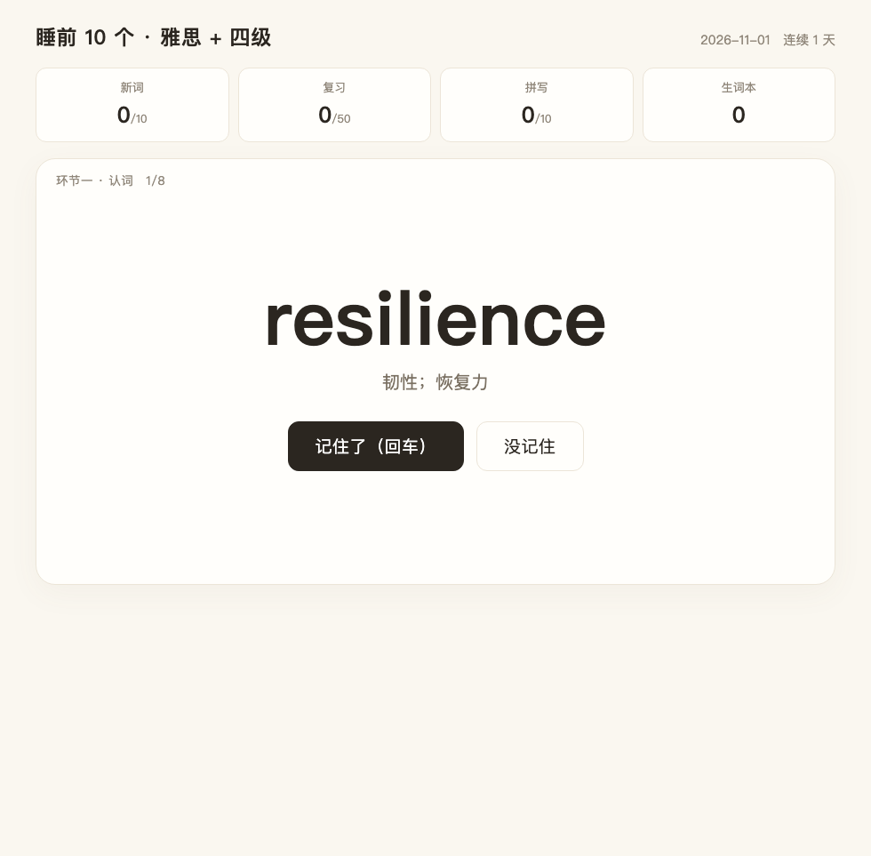
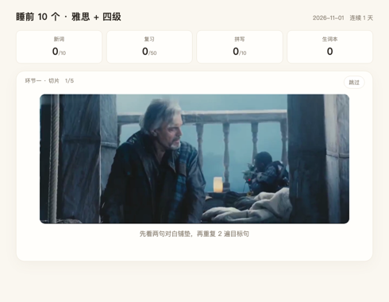
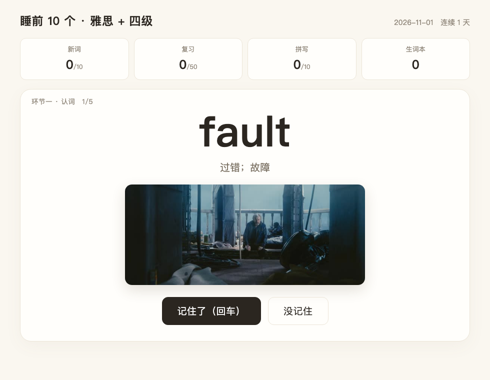
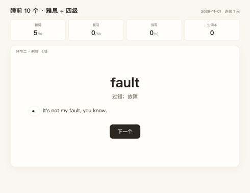
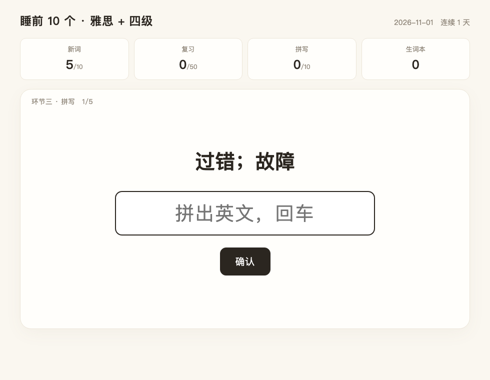

# English from Shows · 从剧集里挖单词

一键把**任意剧集**变成一套带片段的背单词工具：

```
剧集视频 → 语音识别（词级时间戳）→ 对齐四六级/雅思词表 → 自动切 10 秒片段（含上下文 + 重复 + 字幕）→ 生成练习页
```

> **为什么做这个**：市面上的背单词 App 里，单词和例句是编的。这个项目的每个单词、每句例句、每个视频片段，都来自你正在看的那部剧。




## ⚠️ 免责声明（请先读这一段）

**这是一个语言学习工具，不是下载器，也不包含任何受版权保护的影视内容。**

- 仓库内**没有**任何电影/电视剧的画面、音频或字幕
- 演示片段来自开源电影 *Tears of Steel*（CC BY 3.0）
- 本工具**不提供**获取影视资源的渠道，也**不含**任何破解或绕过限制的功能
- 使用者必须对自己处理的视频拥有合法使用权，**不得传播生成的片段**
- 本项目按“现状”提供，不附带任何担保

完整条款见 **[DISCLAIMER.md](DISCLAIMER.md)**。

## 它解决什么问题

传统背单词的两个断点：

1. **记不住**——词表里的例句是造的，跟你的生活没关系
2. **听不懂**——背了单词，但在真实语流里反应不过来

这个项目把两者接上：**你听到的就是你背的**。

## 工作流

```
videos/          你把剧集放进来（mp4）
  ↓ transcribe_only.py    faster-whisper 逐词时间戳
cache/*.json     转写缓存
  ↓ build_vocab.py        与四六级/雅思词表取交集 + 难度过滤
words.js         词表（带剧中原句）
  ↓ make_clips_v2.py      按停顿切句，切「上下文 + 目标句 ×2」，烧字幕和词标签
clips/*.mp4      单词片段
  ↓ grab_stills.py        抓单词发音那一帧
clips/img/*.jpg  记忆定格
  ↓ gen_tts.py            edge-tts 生成单词与例句音频
audio/tts/*.mp3  本地音频
```

生成的 `app/index.html` 直接打开即可使用。

**想先看界面？** 复制一份 demo 数据：

```bash
cp app/words.demo.js app/words.js
open app/index.html
```

`words.demo.js` 指向仓库自带的 **5 段真实剧集片段**，来自开源电影 **《Tears of Steel》**：
真实对白、真实画面、真实切句效果——所以克隆下来就能跑通「片段 → 单词 → 例句 → 拼写」的完整流程。

> 素材：**Tears of Steel** © Blender Foundation | [mango.blender.org](https://mango.blender.org)
> 许可：**CC BY 3.0**（可自由复制、分发、商用，需署名）
> 仓库内只保留 5 段各 3–5 秒的教学片段，用于演示流程。

**换成你自己的剧**：删掉 `docs/demo-clips/`，把你的视频放进 `videos/` 跑一次 pipeline 即可。

## 学习流程（截图来自仓库自带演示数据）

| ① 看片段 | ② 认词 |
|---|---|
|  |  |

| ③ 例句（出现即朗读） | ④ 汉译拼写（背景放原片声音） |
|---|---|
|  |  |

## 四环节说明

| 环节 | 内容 |
|---|---|
| 一 | 看片段 → 单词 → 记住 / 没记住（回车继续） |
| 二 | 一次一个例句，出现即朗读 |
| 三 | 汉译拼写，背景播放该词的切片原声 |
| 四 | 没记住 + 拼错的词，二次巩固 |

每 10 个词一组，走完自动进入下一组。

## 快速开始

```bash
# 1. 依赖
pip install faster-whisper edge-tts imageio-ffmpeg wordfreq

# 2. 放剧集
mkdir -p videos && cp /path/to/your/episode.mp4 videos/

# 3. 跑完整流水线
./scripts/pipeline.sh
```

词表来源（需自备，二选一）：
- 四级 / 雅思词表 JSONL，放到 `data/cet4.jsonl`、`data/ielts.jsonl`
- 或修改 `scripts/build_vocab.py` 顶部的路径

## 目录结构

```
app/          学习页面（纯前端，无依赖）
scripts/      流水线脚本
docs/         截图
videos/       你放的剧集（.gitignore）
cache/        转写缓存（.gitignore）
clips/        生成的片段（.gitignore）
audio/        生成的音频（.gitignore）
```

## 关于版权（重要）

**本仓库不包含、也不分发任何影视素材。**

仓库里只有：代码、文档、以及一张用示例词表（无视频）截的界面图。

- 仓库自带的 5 段演示片段来自 **CC BY 3.0** 的开源电影《Tears of Steel》，已署名
- 除此之外不含任何影视内容
- 真实视频、片段、截图由使用者自行提供并生成，通过 `.gitignore` 排除
- `import_local_cache.py` 只处理使用者**本机已有的缓存文件**，不下载、不绕过任何平台限制
- 请只在**自己合法持有**的影视文件上使用，不要传播生成的片段
- 本项目不提供影视资源，也不提供获取资源的链接

这是工具的常见定位（与 ffmpeg、PotPlayer 同类）：**工具中立，责任在使用者。**
如你认为本项目有不妥之处，欢迎开 issue 讨论。


## 想换素材？这些是合法可用的

| 来源 | 许可 | 内容 | 能不能商用 |
|---|---|---|---|
| **Tears of Steel / Sintel / Big Buck Bunny** | CC BY 3.0 | Blender 开源电影，有英语对白 | ✅ 可商用，需署名 |
| **NASA 影像库** | 公有领域 | 航天、地球、太空 | ✅ 随便用 |
| **Wikimedia Commons** | 公有领域 / CC | 老电影、纪录片、演讲 | 看单个文件标注 |
| **Library of Congress** | 公有领域 | 早期美国电影 | ✅ |
| **你自己的 DVD / 已购买的数字版** | 个人使用 | 任何剧 | ⚠️ 自己看可以，别分发 |

> 判断标准很简单：**看它有没有明确写 CC0 / CC BY / Public Domain**。
> 写了“仅限学习交流”的，就是没授权。

把这几个来源的视频放进 `videos/`，跑一次 pipeline，就能生成你自己的词库。

## 技术要点

- **词级时间戳**：faster-whisper 的 `word_timestamps=True`，切句按停顿（>0.35s）分段
- **上下文片段**：先取目标句前两句做铺垫，再重复目标句 2 遍，符合"先听懂情境，再聚焦单词"
- **去水印**：ffmpeg `delogo` 滤镜覆盖常见水印位置
- **本地 TTS**：edge-tts 预生成 mp3，避免依赖系统语音和网络

## License

MIT
